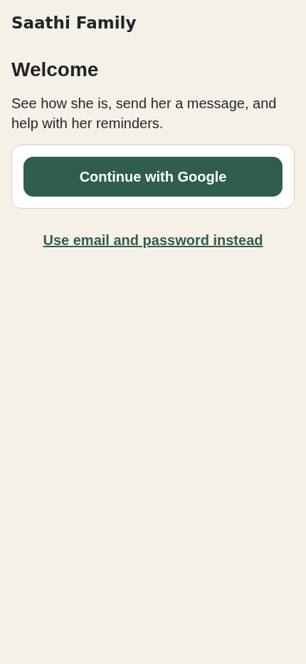
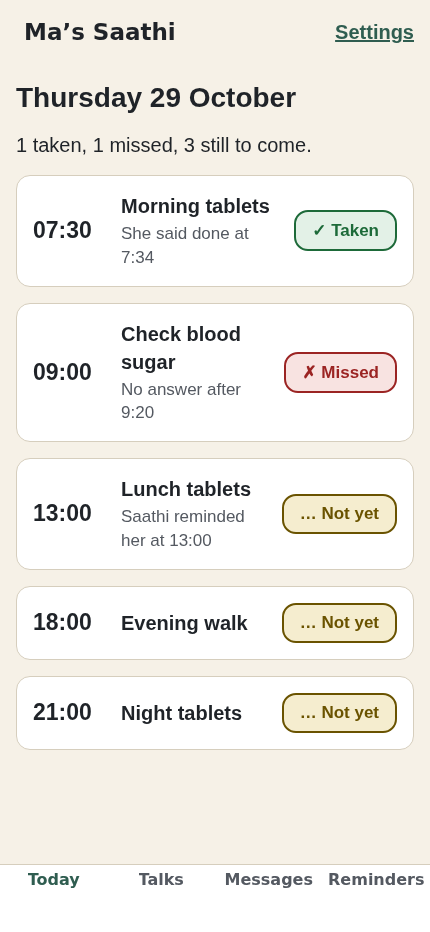
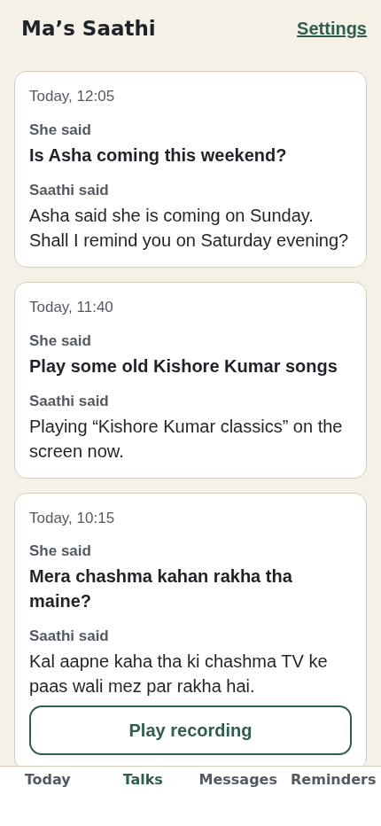
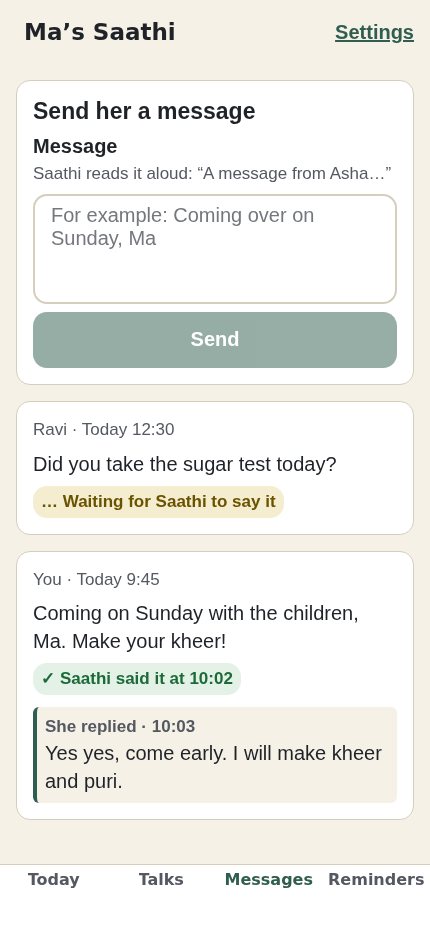
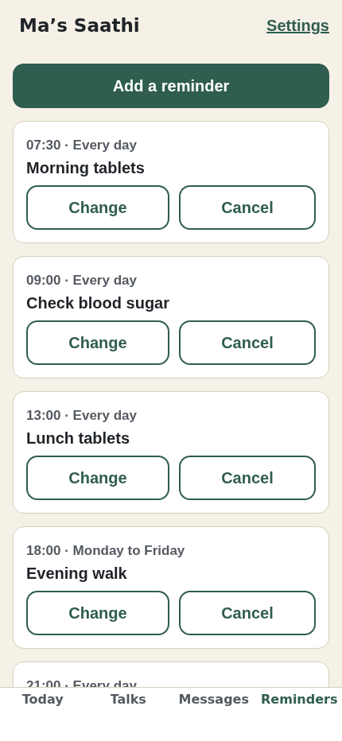

# Saathi Family — the caregiver app

For the people who look after her: her son, her daughter, a nurse. They
pair once with her Saathi, and from then on they can:

- see whether she took her reminders today (**Today**);
- read and listen to her conversations with Saathi (**Talks**);
- send a message Saathi reads aloud, and see whether it was said yet and what she answered (**Messages**);
- set, change and cancel her reminders (**Reminders**);
- change the name Saathi says before their messages, and sign out (**Settings**).

Voice calls come later; they are not in this app yet.

| Sign in | Today | Talks | Messages | Reminders |
|---|---|---|---|---|
|  |  |  |  |  |

## Why Expo

- **One codebase for iPhone and Android.** The family is split across
  both, and a second native app would double every change. The same code
  also builds for the web, which is what the e2e screenshots drive.
- **Room to grow into calls.** When VoIP comes, Twilio's Voice SDK has a
  React Native package (`@twilio/voice-react-native-sdk`); an Expo dev
  build can carry any native module, so calls arrive without leaving the
  stack. (Not verified yet; that's the calling unit's first check.)
- **No Xcode or Android Studio needed to ship.** EAS builds in the cloud,
  like the tablet's APK is built in GitHub Actions.

What lost, and why, is in the root `DECISIONS.md` (2026-10-29, caregiver
app): Flutter, a PWA only, and a separate repo.

## How it's put together

```
src/
  firebase.ts        which Firebase: the real project or the emulators
  authInit*.ts       session persistence (web/Node vs. iOS/Android)
  data/              THE SEAM — every Firestore/Storage call lives here
    auth, google, devices (pairing), today, turns, messages, reminders,
    users, push
  state/session.tsx  signed-in user, paired devices, the chosen device
  ui/                theme (large type, AA contrast), a small kit, and
                     GoogleSignIn (web popup / native OAuth)
rules/               symlink to ../../contracts: the rules the tests run under
  app/               expo-router screens; they call src/data and nothing else
tests/               Jest: pure logic + the data layer against the emulators
e2e/                 seed the emulators; drive the web build; screenshots
```

Screens never import from `firebase/*`. If the contract in `contracts/`
moves, `src/data/types.ts` and its converters move with it, not the UI.

## Run it against the emulators (no Firebase project needed)

Node 22 and firebase-tools are needed (Java 21 for the Firestore
emulator). From `apps/caregiver`:

```sh
npm install

# 1. Emulators on this app's ports: auth 9193, firestore 8183, storage 9293
firebase emulators:start --config firebase.test.json \
  --only auth,firestore,storage --project demo-saathi

# 2. In another terminal: a believable day of data
npm run seed          # "Use email and password instead", then
                      # asha@example.com / saathi-demo. A new account
                      # can pair with code 246 810 (live for 10 minutes).

# 3. The app, pointed at the emulators
EXPO_PUBLIC_USE_EMULATORS=1 EXPO_PUBLIC_FIREBASE_PROJECT_ID=demo-saathi npx expo start
```

Press `w` for the browser. On a phone (Expo Go or a dev build) also set
`EXPO_PUBLIC_EMULATOR_HOST` to your laptop's LAN address (or `10.0.2.2`
in the Android emulator).

## Tests

```sh
npx tsc --noEmit         # strict TypeScript, the whole app
npm run test:emulators   # = firebase emulators:exec … "npm test"
```

`npm test` on its own needs the emulators running and says so if they
aren't. The emulator tests run under the project's **real** security
rules: `rules/` is a symlink to `contracts/`, so there is one copy.
A link, not a `../../contracts` path in `firebase.test.json`: the
Firebase CLI refuses rules from outside the config's directory.

The tests act as the real parties: the caregiver goes through
`src/data`, "the device" is its own `device-{id}@saathi.invalid`
account, and a second family member uses their own client. Google
sign-in is tested with the Auth emulator's fake ID tokens, through the
same `signInWithGoogleIdToken` a phone calls.

### Screenshots (web e2e)

```sh
EXPO_PUBLIC_USE_EMULATORS=1 EXPO_PUBLIC_FIREBASE_PROJECT_ID=demo-saathi npx expo export --platform web
python3 -m http.server 8790 --bind 127.0.0.1 --directory dist &
npm run seed && npm run screenshots   # -> docs/screenshots/
```

It signs in with email, opens every tab, adds a reminder, signs out,
creates a second account and pairs it. It fails if a screen never
shows what it should. Google's popup can't be driven headless; the
emulator tests cover that path.

## What the owner needs to do

The project exists (`speedy-district-509007-f0`), and Google sign-in is
enabled. The remaining steps:

1. **Authentication → Sign-in method → Email/Password**: enable it too.
   The tablet signs in with its own email account, and it's the
   caregivers' second option.
2. **Firestore Database** and **Storage** (the default bucket holds
   conversation audio): create them, then deploy the rules from
   `contracts/`.
3. **Project settings → Your apps → Add app → Web**: register "Saathi
   Family" if it isn't there. The public config for it is already in
   `.env.example`, as comments.
4. In `apps/caregiver`, run `cp .env.example .env` and fill in the
   values, including the API key from the same console page. Leave
   `EXPO_PUBLIC_USE_EMULATORS=0`. `.env` is gitignored; never commit it.
5. **Authentication → Settings → Authorized domains**: add whatever
   domain the web build is served from (localhost is already there).

### Google sign-in on phones

Web needs nothing more: Firebase's popup handles it. iPhone and Android
need OAuth client IDs, from **Google Cloud console → APIs & Services →
Credentials** in the same project:

- **iOS client**, bundle ID `com.saathi.caregiver` →
  `EXPO_PUBLIC_GOOGLE_IOS_CLIENT_ID`. Also add its *reversed* client ID
  (`com.googleusercontent.apps.…`) as a URL scheme: in `app.json`,
  `expo.ios.infoPlist.CFBundleURLTypes`. Google redirects back to the
  app through that scheme.
- **Android client**, package `com.saathi.caregiver` plus the SHA-1 of
  the signing key (`eas credentials` shows it) →
  `EXPO_PUBLIC_GOOGLE_ANDROID_CLIENT_ID`.
- **Web client**: Firebase already created one ("Web client (auto
  created by Google Service)") → `EXPO_PUBLIC_GOOGLE_WEB_CLIENT_ID`.

Without them the phone app hides the Google button behind a short note
and email still works. This needs a dev build (`eas build --profile
development`), not Expo Go. Expo now steers Google sign-in towards
`@react-native-google-signin/google-signin`; see DECISIONS.md for why
it wasn't used yet.

For push notifications on Android, later: add an Android app in the
same project with package `com.saathi.caregiver`, download
`google-services.json`, point `expo.android.googleServicesFile` in
`app.json` at it, and make a dev build. iPhone push needs an APNs
key uploaded to Firebase — see DECISIONS.md; until then the app works
without push on iPhone.
